<div align="center">

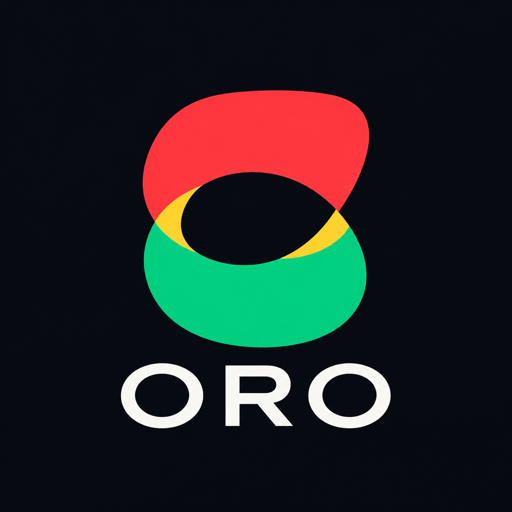

# ORO

**Before you believe it, verify it.**

I built ORO to check Indian stock-market tips against official exchange filings and SEBI records,
and to show investors only the verified news that touches their own money.

[**Live site → orosworld.in**](https://orosworld.in) · [Product plan](docs/PLAN.md)


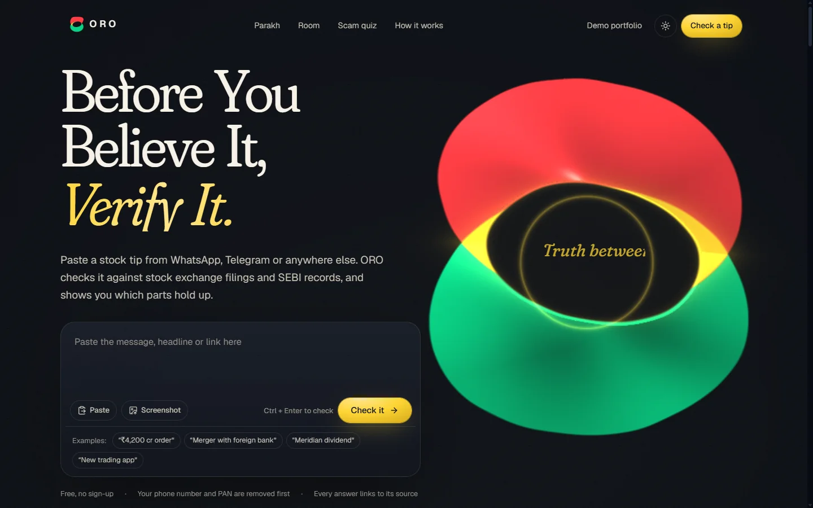

</div>

---

## Contents

- [Why ORO?](#why-oro)
- [What ORO does?](#what-oro-does)
- [Screenshots](#screenshots)
- [What this project shows](#what-this-project-shows)
- [Tech stack](#tech-stack)
- [Architecture](#architecture)
- [How a tip is checked](#how-a-tip-is-checked)
- [How Room and Ask Room work](#how-room-and-ask-room-work)
- [Repository layout](#repository-layout)
- [Run it locally](#run-it-locally)
- [Configuration](#configuration)
- [Testing](#testing)
- [Deployment](#deployment)
- [Security and privacy](#security-and-privacy)
- [Problems I ran into](#problems-i-ran-into)
- [What's next](#whats-next)
- [About us](#about-us)

---

## Why ORO?

Most stock tips in India arrive on WhatsApp or Telegram: "₹4,200 crore order coming, buy before
tomorrow", "SEBI-approved multibagger", "100% sure shot". Some are pump-and-dump schemes. Some are
real news with one number changed. The truth is usually in a public BSE or NSE filing, but almost
nobody digs it out before acting on a tip. I wanted a tool that does the digging in a few seconds.

## What ORO does?

| Product | What it does |
|---|---|
| **Parakh** (परख, "to assay") | Paste any tip, forward, headline, link or screenshot. ORO removes personal details, runs scam-pattern rules, pulls out each factual claim and checks it against exchange filings and SEBI records. You get a **Karat score from 0 to 24**, a risk band, and the exact source line behind every verdict. |
| **Room** | Upload a CAS statement (CDSL, NSDL, CAMS, KFintech) or a broker CSV. Room looks *inside your mutual funds* to the companies they hold, then shows only filings about companies your money is actually in, sized in rupees. |
| **Ask Room** | Ask in plain English or Hinglish, like "How much of my money is in IT companies?" Answers come only from filings and your own holdings, with numbered sources. Without signing in, you can ask about any listed company. |
| **Scam quiz and library** | A swipe game and ten common Indian stock-scam patterns, explained step by step. |
| **Alerts** | Web Push notifications for important filings about your holdings, with quiet hours and a daily cap. |

> ORO checks facts. It never gives buy, sell or hold advice. Every sentence it writes passes an
> advice filter (English, Hindi and Hinglish) so it stays within SEBI's research-analyst rules.

## Screenshots

<table>
  <tr>
    <td width="50%">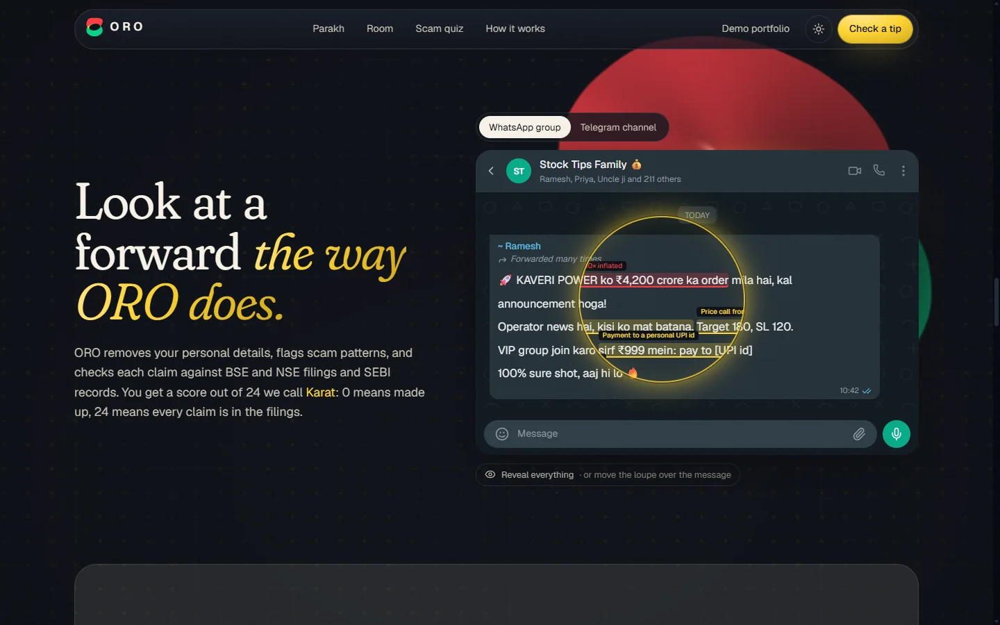<br /><sub><b>The loupe.</b> Move the magnifier over a forwarded tip to see what ORO finds. WhatsApp and Telegram versions.</sub></td>
    <td width="50%">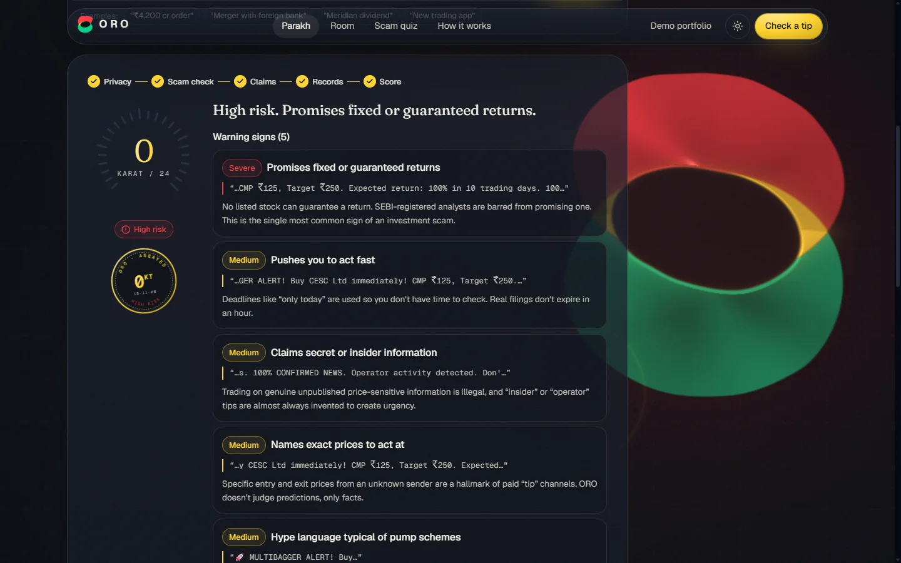<br /><sub><b>A live verdict.</b> Karat 0, High risk, each warning sign quoted from the message.</sub></td>
  </tr>
  <tr>
    <td>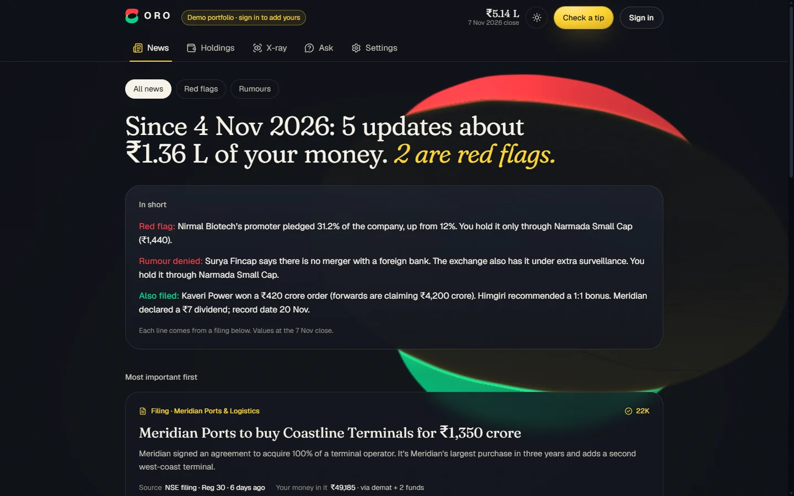<br /><sub><b>Room → News.</b> Only filings about what you own, most important first.</sub></td>
    <td>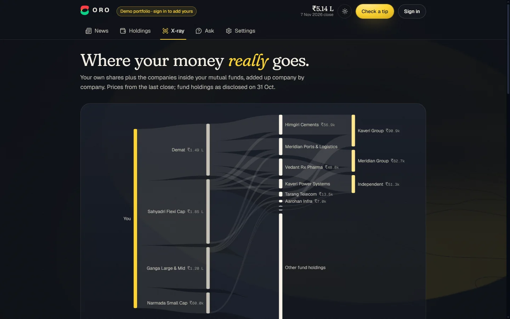<br /><sub><b>Room → X-ray.</b> Every rupee traced through your funds to companies and business groups.</sub></td>
  </tr>
  <tr>
    <td>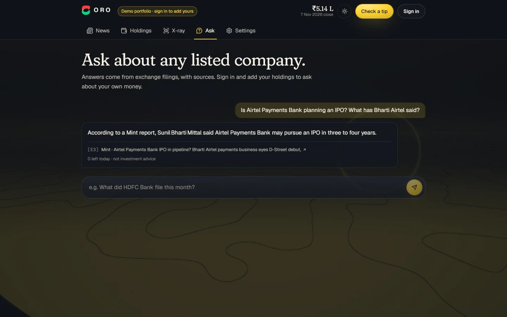<br /><sub><b>Ask Room.</b> Answers from filings and news, with numbered sources.</sub></td>
    <td>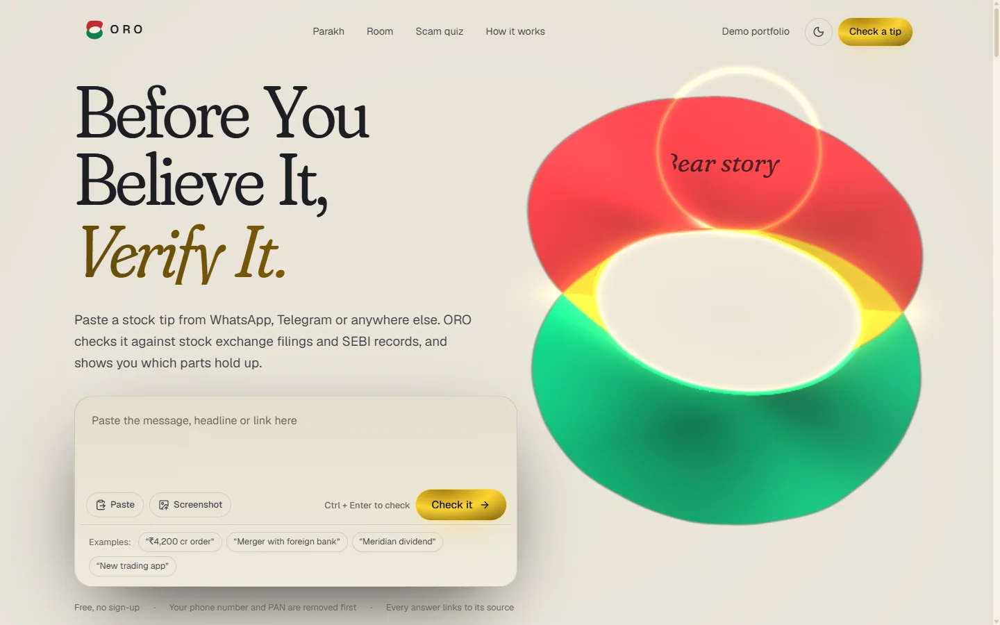<br /><sub><b>Light theme.</b> The magnifier reveals words hidden on the logo: Bear story, Bull story, Truth between.</sub></td>
  </tr>
</table>

<p align="center">
  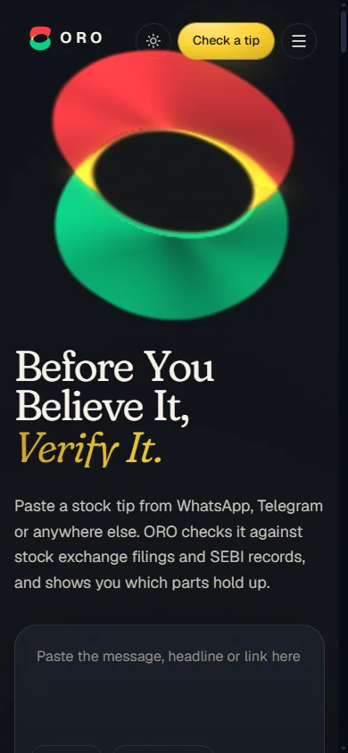
  &nbsp;&nbsp;
  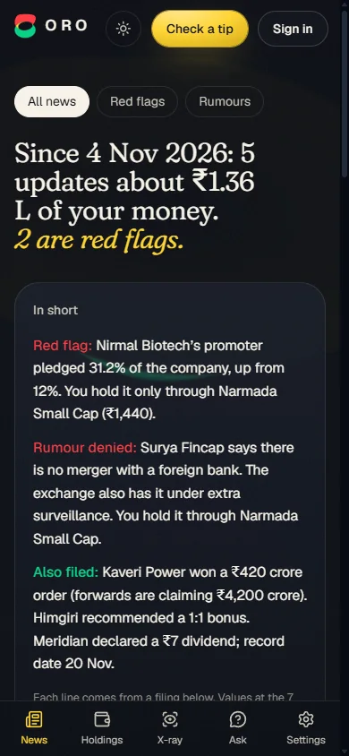
</p>

## What this project shows

We designed and built ORO, end to end: product, design, frontend, backend, AI,
infrastructure and deployment. It runs in production on free AI tiers and student cloud credits.

| Area | What I built |
|---|---|
| **Full-stack product** | A Next.js 16 / React 19 frontend and a FastAPI backend behind a backend-for-frontend proxy, with sign-in, consent tracking, data export and account deletion. |
| **Applied AI (RAG)** | Hybrid search (pgvector HNSW + Postgres full-text, merged with Reciprocal Rank Fusion), a self-hosted embedding model, LLM verdicts where code checks every quoted line, and a router that spreads work across AI providers within daily token budgets. |
| **Real-time systems** | Results stream to the browser over Server-Sent Events backed by Redis Streams, and can resume after a dropped connection. A pipeline service reads NSE, BSE and SEBI feeds, extracts PDF text, links companies and pushes news into user feeds. |
| **Data engineering** | Parsers for CAS statements and broker CSVs, ISIN matching, look-through exposure from fund disclosures, industry and business-group classification. |
| **Security and privacy** | Personal-data scrubbing before storage or AI calls, field-level encryption, keyed hashing, an SSRF-safe link reader, rate limits and quotas, bot protection, consent and deletion. |
| **DevOps** | Docker Compose with profiles for small machines, Caddy with automatic HTTPS through Cloudflare DNS, a locked-down Azure VM, GitHub Actions CI and auto-deploy. |
| **Design and motion** | A WebGL shader logo that reacts to scrolling, GSAP animation, a magnifier interaction, dark and light themes, and a layout tested on phone, tablet and desktop. |

## Tech stack

| Layer | Technology | Why I picked it |
|---|---|---|
| Frontend | **Next.js 16** (App Router, Cache Components, standalone output), **React 19**, **TypeScript** | Server-rendered public pages, streaming, type safety |
| Styling and motion | **Tailwind CSS 4**, **GSAP**, **Lenis**, **Three.js / React Three Fiber** (custom GLSL shader), **d3-sankey** | Themeable design tokens, the animated logo, the money-flow diagram |
| Auth | **Better Auth** (email + password, Google ready), **jose** JWTs for the API | Sessions stay in the web app; the API only accepts 5-minute signed tokens |
| Backend API | **FastAPI** (Python 3.12), **Pydantic v2**, **SQLAlchemy 2** (async), **Alembic** | Async I/O, typed schemas, migrations |
| Database | **PostgreSQL 17 + pgvector** | Relational data, vector search and full-text search in one place |
| Queues and cache | **Redis** (Streams, sorted sets, counters), **Celery** worker + beat | Event pipeline, user feeds, rate limits, scheduled jobs |
| AI | **Groq** (`gpt-oss-120b`, a vision model for screenshots), **Gemini** (public filings only), optional **Claude**, **EmbeddingGemma-300M** (fastembed / ONNX) | Free first, and each provider only sees the data it's allowed to |
| Hosting | **Cloudflare** (DNS, proxy, firewall), **Caddy**, **Azure** ARM VM, **Docker Compose** | HTTPS everywhere at very low cost |
| CI/CD | **GitHub Actions**, a systemd timer on the server | Every push is tested; the server deploys itself |
| Testing | **pytest** (98 tests, including database integration), **Vitest** (20 tests), **Playwright** for visual checks | |

## Architecture

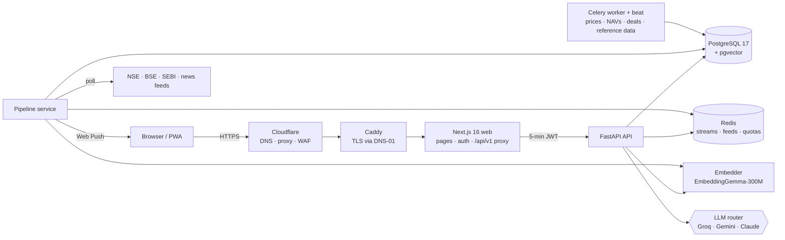

- The API is never exposed to the internet. The browser only talks to the Next.js app, which
  forwards `/api/v1/*` with a short-lived signed token.
- Each AI provider only sees what it's allowed to. Tips go to Groq after personal details are
  removed, and Gemini's free tier only ever gets public filings.
- The whole stack runs from one `docker compose` file, with `lite` and `small` versions for
  6 GB laptops and 2–4 GB servers.

## How a tip is checked

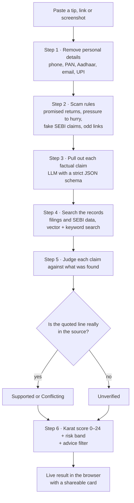

Each step is sent to the browser as soon as it finishes (Server-Sent Events over Redis Streams), so
you see the check happen live. It usually takes 2 to 8 seconds.

The Karat score uses a public formula, so anyone can recompute it:

```
karat = clamp(round(12 + evidence + source + language + scam), 0, 24)
```

- **evidence:** +3 for each supported claim, −5 for each conflicting one (weighted by how official the source is)
- **source:** +3 if the message came from a filing or regulator, −3 if the origin is unknown
- **language:** −1 for each hedge or missing attribution
- **scam:** −2 for each medium warning sign, −6 for each severe one

## How Room and Ask Room work

1. **Import.** A CAS PDF or broker CSV is read in memory and never saved. Holdings are matched to
   companies and funds by ISIN, and quantities are encrypted in the database.
2. **Look-through.** Fund disclosures turn "₹1.85 L in a flexi-cap fund" into rupees per company,
   business group and industry. That's the X-ray.
3. **News feed.** The pipeline links every new filing to the companies it mentions, indexes it,
   and adds it to the feed of everyone who owns those companies, ranked by how much money is
   involved and how serious it is.
4. **Ask Room.** Questions asking for advice are refused without calling the AI. For the rest, ORO
   searches filings about the companies involved, adds facts about your portfolio, and asks the
   LLM to answer citing only the sources it was given. An answer with no valid source is replaced
   by an honest "not in the records yet".

## Repository layout

```
.
├── apps/web/                 Next.js 16 frontend
│   └── src/
│       ├── app/(site)/       Public pages: home, Parakh, scams, pricing, methodology, verdict pages
│       ├── app/(room)/       Room: news, holdings, X-ray, Ask, settings
│       ├── app/api/          Proxy to the API, auth routes, live check stream, share-card images
│       ├── components/       landing/, assay/ (Parakh UI), room/, field/ (WebGL shader), site/
│       └── lib/              engine/ (rules fallback in TypeScript), room/, server/ (auth, API client)
├── backend/                  FastAPI service
│   ├── app/
│   │   ├── api/routes/       checks (live stream), room, alerts, market, account, admin
│   │   ├── verify/           Parakh engine: scrubbing, scam signals, claims, judge, Karat, advice filter
│   │   ├── retrieval/        Hybrid search (pgvector + full text)
│   │   ├── llm/              AI provider router, prompts, token budgets, vision
│   │   ├── embed/            Embedding service (EmbeddingGemma-300M)
│   │   ├── ingest/           NSE/BSE/SEBI/news readers, PDFs, link reader, reference data
│   │   ├── pipeline/         Document store and Redis Streams consumer
│   │   ├── room/             CAS/CSV import, holdings, exposure, feed, Ask Room
│   │   └── alerts/           Web Push
│   ├── alembic/              Database migrations
│   └── tests/                pytest (unit + Postgres integration)
├── infra/                    Docker Compose, Caddy, deploy / backup / auto-deploy scripts, Azure VM script
├── docs/
│   ├── PLAN.md               Product plan and roadmap
│   └── assets/               Logo and screenshots
├── .github/workflows/ci.yml  CI for backend and web
└── .env.example              All settings, with secrets shown as xxxxx
```

## Run it locally

You need Docker Desktop (about 3 GB of RAM for the lite setup), or Python 3.12 and Node 24 to run
the services directly.

```bash
git clone https://github.com/shreepalbishnoi/oro.git
cd oro
cp .env.example .env            # works as-is locally; add your own keys to turn on the AI parts

# Everything: Postgres, Redis, API, embedder, pipeline, worker and the web app on http://localhost:3000
docker compose --env-file .env -f infra/docker-compose.yml up -d --build
# On a ~6 GB machine, add the lite file (no embedder, keyword search only):
#   docker compose --env-file .env -f infra/docker-compose.yml -f infra/docker-compose.lite.yml up -d --build

# Load reference data (companies, prices, deals)
docker compose --env-file .env -f infra/docker-compose.yml exec api python -m app.ingest.reference.instruments
docker compose --env-file .env -f infra/docker-compose.yml exec api python -c "from app.worker import eod_prices, deals; eod_prices(); deals()"
```

Just the frontend (it falls back to a built-in TypeScript rules engine when the API isn't running):

```bash
cd apps/web
npm install
npm run dev                     # http://localhost:3000
```

Without AI keys, Parakh still works on rules and records, and Ask Room says the AI is unavailable.

## Configuration

Settings live in `.env`, copied from `.env.example`. Every secret there is written as `xxxxx`, and
any value left as `xxxxx` counts as "not set", so that feature simply stays off.

| Variable | What it's for | Value |
|---|---|---|
| `GROQ_API_KEY` | Claim extraction, verdicts, Ask Room, reading screenshots | `xxxxx` |
| `GEMINI_API_KEY` | Summaries of public filings only | `xxxxx` |
| `ANTHROPIC_API_KEY` | Optional paid AI tier with a daily ₹ cap | `xxxxx` |
| `AUTH_JWT_SECRET`, `BETTER_AUTH_SECRET` | Signing sessions and API tokens | `xxxxx` |
| `HASH_PEPPER`, `FIELD_KEY_B64` | Keyed hashing and field encryption | `xxxxx` |
| `TURNSTILE_SECRET`, `NEXT_PUBLIC_TURNSTILE_SITE_KEY` | Bot protection | `xxxxx` |
| `GOOGLE_CLIENT_ID`, `GOOGLE_CLIENT_SECRET` | Google sign-in | `xxxxx` |
| `VAPID_PUBLIC_KEY`, `VAPID_PRIVATE_KEY` | Web Push alerts | `xxxxx` |
| `CLOUDFLARE_API_TOKEN` | HTTPS certificates in production | `xxxxx` |
| `SITE_DOMAIN`, `PUBLIC_WEB_URL` | Your domain | `example.in` |

## Testing

```bash
# Backend (integration tests need TEST_DATABASE_URL pointing at Postgres with pgvector)
cd backend
python -m venv .venv && .venv/bin/pip install -e ".[dev,embed]"   # .venv\Scripts on Windows
pytest -q
ruff check . && ruff format --check .

# Frontend
cd apps/web
npx next typegen && npx tsc --noEmit
npx eslint src
npx vitest run
```

GitHub Actions runs the backend tests (with a real Postgres + pgvector), a migration check,
TypeScript, ESLint and a full production build on every push. The tests cover personal-data
scrubbing, scam rules (including real tip samples), quote checking, the advice filter, prompt
injection, the link reader's SSRF guard, CAS/CSV import, exposure maths, Ask Room sources, rate
limits and the live stream.

## Deployment

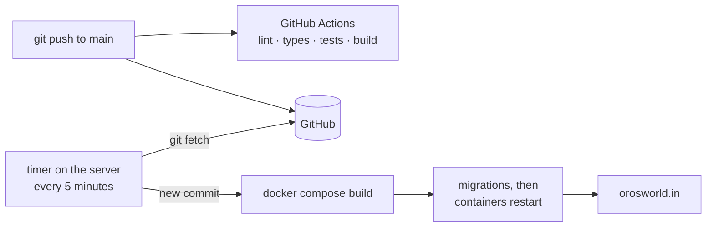

- The server checks GitHub every 5 minutes with a read-only deploy key and rebuilds when `main`
  changes, so CI never needs access to the server.
- It runs on an Azure ARM VM (2 vCPU, 4 GB) in Central India. The firewall only accepts web
  traffic from Cloudflare.
- Caddy gets HTTPS certificates through the Cloudflare DNS API. Cloudflare runs in Full (strict) mode.
- `infra/provision.sh` sets up a fresh Ubuntu server and `infra/deploy.sh` deploys. The same
  scripts also work on a home PC through Cloudflare Tunnel (`ORO_EDGE=tunnel`).
- `infra/backup.sh` makes encrypted database backups for Cloudflare R2.

## Security and privacy

- **Personal details go first.** Phone numbers, PAN, Aadhaar, emails, bank and UPI ids are removed
  before anything is stored or sent to an AI model.
- **Statements are never saved.** CAS files are read in memory, PAN is kept only as a keyed hash,
  and holding quantities are encrypted.
- **Tips can't take control.** Message text is treated as data, the AI judge has no tools, output
  must match a schema, and quotes are checked by code.
- **The link reader is SSRF-safe.** Public IPs only, ports 80 and 443, every redirect re-checked,
  size and time limits.
- **Abuse limits.** Per-minute and daily limits per IP and per user, Turnstile, and daily AI token
  budgets per provider.
- **Your data, your call.** Consent is recorded per purpose, and you can export your data or delete
  your account and everything linked to it.
- **No secrets in this repo.** `.env` files are git-ignored and every key here is `xxxxx`.

## Problems I ran into

- **Checks that froze halfway.** The live stream read Redis with a 15-second blocking call, but the
  client gave up after 2 seconds. Any step slower than that silently killed the stream. Blocking
  reads now use their own client with a longer timeout, and a test guards it.
- **A search model that kept crashing.** Big batches of long texts pushed the embedding model past
  its memory limit and it restarted every few minutes. Now it embeds one document at a time and
  lets live searches go first, so a check waits about 2 seconds at most.
- **Words that only show through the magnifier.** The WebGL logo publishes its shape and the
  magnifier position every frame. The words are placed in the shader's coordinates and masked to
  the same circle the shader magnifies.
- **A deploy that failed because of fonts.** Google Fonts timed out during a server build, so the
  fonts now ship with the code.

## What's next

- A calendar of results, AGMs and record dates
- Full mutual-fund look-through from AMC monthly files
- Telegram and email alerts
- Family view and Guardian alerts
- Published accuracy results for each version

More detail in [docs/PLAN.md](docs/PLAN.md).

## About us

We build full-stack web apps, AI and
RAG features, data pipelines and the infrastructure to run them. We're open to freelance and
full-time work.
Any enquirey or issues with website or curious to know more. Contact: `shreepalbishnoi360@gmail.com` [@shreepalbishnoi](https://github.com/shreepalbishnoi) or [@martial-gautam](https://github.com/Martial-Gautam)

© 2026 ORO. All rights reserved. The code is here for people to read and review. Please ask
before reusing it.
